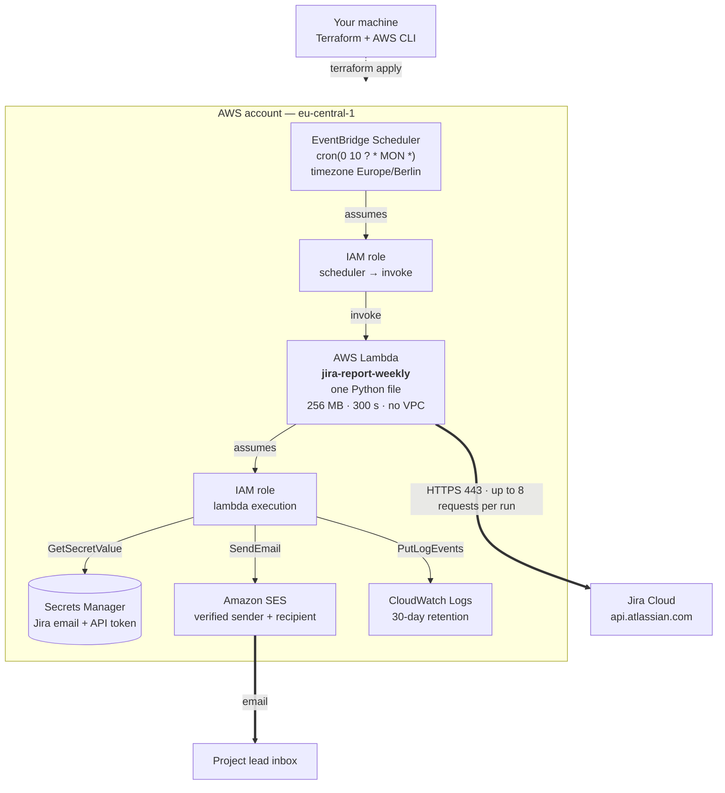
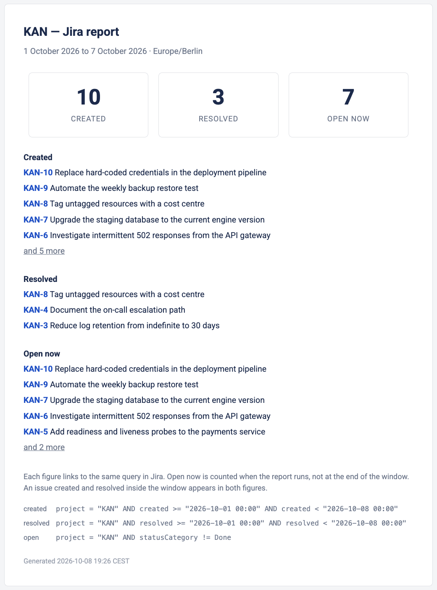

# Jira report

Counts the issues **created**, **resolved** and **currently open** in one Jira Cloud project over
the past week, and emails the result to the project lead every Monday at 10:00 Europe/Berlin.

All data comes from the Jira Cloud REST API. No Jira Automation rules are used.

---

## What is where

| What | Where |
|---|---|
| Steps, tools, commands, assumptions | [2. Assumptions](#2-assumptions) and sections [5](#5-step-1--set-up-jira), [6](#6-step-2--run-it-on-your-machine), [7](#7-step-3--deploy-to-aws) |
| The code | [jira_report.py](jira_report.py) and [terraform/](terraform), walked through in [8. How it works](#8-how-it-works) |
| Compute resources and infrastructure | [3. Architecture](#3-architecture), diagram in [3.1](#31-diagram) |
| External services | [4. What you need](#4-what-you-need) |
| Sample output and email screenshot | [9. Sample output](#9-sample-output) |
| Error handling | Retry with backoff in `_http_json`, time-zone guard in `verify_account`, response checks in `count_issues`, three scheduler retries |
| Links to the Jira issues | Each figure links to its query; the newest issues behind it link individually |
| Date ranges and filters | `--since` and `--until`, locally or in the invocation payload, plus `JIRA_ISSUE_TYPES` and `JIRA_PRIORITIES` |

---

## 1. Overview

The whole program is one file, [jira_report.py](jira_report.py), written against the Python
standard library only. There is nothing to `pip install` and no build step — Terraform zips that
single file and deploys it.

You will do three things, in this order: create a Jira project and an API token in a browser, run
the report on your own machine, then deploy it to AWS. Allow about half an hour, most of it spent
waiting for confirmation emails.

Step 2 before step 3 is deliberate: if the numbers are right locally, anything that then fails in
AWS is an infrastructure problem, not a logic problem. That halves the places you have to look.

---

## 2. Assumptions

| # | Assumption |
|---|---|
| A1 | **Jira Cloud**, not Jira Server or Data Center. The `/rest/api/3` path used here is Cloud-only. |
| A2 | The examples use the site `https://acme.atlassian.net` and the project key `ACME`. Both are placeholders — substitute your own everywhere. |
| A3 | Authentication is an Atlassian account **email + API token** over HTTP Basic. Not OAuth, which needs a human to approve a grant and so cannot run unattended. |
| A4 | The script only ever reads, and the token it uses carries read scopes only — see [12. Security](#12-security). |
| A5 | The reporting window is the last 7 full days, `[Monday−7d 00:00, Monday 00:00)` in Europe/Berlin. The end is excluded, so consecutive weeks never overlap. |
| A6 | **"Open"** means `statusCategory != Done`. Status *categories* survive workflow customisation; literal status names like `Open` do not. |
| A7 | **"Resolved"** means the issue got a resolution inside the window. An issue created *and* resolved in the same week is counted in both figures, and the email says so. |
| A8 | **"Open"** is a snapshot at the moment of the run, not at the window's end. The email repeats this to its reader. |
| A9 | AWS region `eu-central-1`. Amazon SES runs in **sandbox** mode, which only delivers to addresses you have confirmed — enough for one known recipient, and it avoids requesting production access. |
| A10 | The Lambda has no VPC. It reaches the internet outbound only; nothing can reach it inbound. |

---

## 3. Architecture

### 3.1 Diagram



### 3.2 Why Lambda

The job runs about four times a month for a few seconds. Lambda costs nothing when idle, has no
operating system to patch, and reaches Secrets Manager and SES through IAM without stored
credentials. EC2 would mean paying for ~720 idle hours a month and nursing a cron daemon; a
container would mean an image and a task definition for a few hundred lines of Python; Atlassian
Forge runs inside Atlassian's own platform, the same category of tool as Jira Automation, which
this project avoids on purpose — every figure comes from the REST API.

**EventBridge Scheduler, not a classic EventBridge rule.** Scheduler understands IANA time zones,
so "Monday 10:00 in Berlin" survives the clock change. Classic rules are UTC-only and would drift
by an hour twice a year.

### 3.3 Resources

`terraform plan` reports **12 resources**, all declared in [terraform/main.tf](terraform/main.tf)
and all named from one variable, `name_prefix`. The diagram above shows how they connect; the
file is the authoritative list, down to each policy statement.

The repository and script are called `jira-report` without a cadence because the window length is
a parameter — only this *deployment* is weekly. A daily report would be a second `.tfvars`, not
new code.

### 3.4 Permissions

Both roles are least-privilege: every statement names an exact ARN rather than a wildcard, so the
function can read its own secret, send only from the configured address, and write only to its own
log group. The scheduler's role may invoke this one function, and its trust policy is pinned to
this account with `aws:SourceAccount`, so a scheduler in someone else's account cannot borrow it.
The policy documents are in [terraform/main.tf](terraform/main.tf).

The function is not in a VPC. It reaches three hosts on port 443 — your Jira site, Secrets Manager
and SES — through an AWS-managed interface, and nothing can reach it inbound.

---

## 4. What you need

Install these first. The version column is the lowest that works, not what to install — newer is
fine, and each row says what this project was verified on. The install column is macOS; all four
tools ship for Linux and Windows too, and nothing below depends on how they were installed.

| Tool | Minimum | Why | Install on macOS | Check it worked |
|---|---|---|---|---|
| Web browser | a current release | The Atlassian and AWS consoles. Both vendors support current browsers on a rolling basis rather than naming a fixed minimum version. Walked through on Chrome 155.0.8059.40, Firefox 157.0.1 and Safari 27.0, on macOS 26.7.1. | — | — |
| Python | **3.9** | Runs the report. 3.9 is the floor because the `zoneinfo` module, which does all the time-zone arithmetic, was added in that release. Verified on 3.9.6 — the version macOS already ships as `/usr/bin/python3`. | already installed, or `brew install python@3.14` | `python3 --version` |
| AWS CLI | **2.x** | Credentials and reading logs. Verified on 2.37.10, the version Homebrew ships. | `brew install awscli` | `aws --version` |
| Terraform | **1.11** | Creates every AWS resource. 1.11 is the first version with write-only arguments, which keep the API token out of Terraform's state file. Verified on 1.16.4. | `brew install terraform` | `terraform version` |
| jq | **1.7** | Formats the API responses in the checks below. Verified on 1.7.1. | `brew install jq` | `jq --version` |

You also need an **AWS account** and an **Atlassian account**. Both are free to create.

No Python packages are required. The one library the code uses, `boto3`, is supplied by the AWS
Lambda runtime.

### External services used

| Service | What it is | How this project uses it |
|---|---|---|
| **Jira Cloud** | Atlassian's hosted issue tracker | The source of the numbers. Up to eight REST calls per run: the site's cloud ID, the account check, three counts, and one list of issues per non-empty figure. |
| **AWS Lambda** | Runs code on demand without a server | Executes the script once a week |
| **EventBridge Scheduler** | A managed cron that understands time zones | Starts the Lambda every Monday at 10:00 Europe/Berlin |
| **AWS Secrets Manager** | Encrypted storage for passwords and tokens | Holds the Jira API token; the Lambda reads it at startup |
| **Amazon SES** | AWS's email sending service | Delivers the finished report |
| **Terraform** | Describes infrastructure as text files | One command builds the whole stack |

---

## 5. Step 1 — set up Jira

### 5.1 Create a free Jira site

1. In a current release of Chrome, Firefox or Safari, open a new tab and go to
   `https://www.atlassian.com/software/jira/free`.
2. Click **Get it free** and sign up with an email address you can read.
3. When it asks for a site name, type `acme`. Your site becomes `https://acme.atlassian.net`.
   Site names are globally unique, so if it is taken pick another and use that name everywhere
   below instead.
4. Choose **Jira** when asked which product to set up. Skip the sample project it offers.

### 5.2 Create the project

1. Open `https://acme.atlassian.net/jira/projects`.
2. Click **Create project**, choose **Scrum**, click **Use template**, then
   **Select a company-managed project**.
3. Name it `Acme Platform`. The key fills in automatically as `ACME`. Click **Next**, then
   **Create project**.

### 5.3 Add the person who will receive the report

1. Open `https://admin.atlassian.com`, choose your organisation, then
   **Directory → Users → Invite users**.
2. Enter `your.address+project.lead@gmail.com` and give them access to **Jira**.

   The `+project.lead` part is a Gmail sub-address: mail still arrives in your own inbox, but it
   is a separate address as far as Jira and AWS are concerned — that is what lets one mailbox
   play both roles. Outlook and Proton do the same; if your provider does not, use any second
   address you can read.
3. Open the invitation from your inbox and finish the signup so the account becomes active.
4. In Jira, open **Project settings → Details**, set **Project lead** to that user, and save.

### 5.4 Set the time zone — do not skip this

Jira reads dates in a query using the time zone of the account making the request, not UTC. If
that zone does not match the report's, every weekly boundary silently shifts and the numbers are
quietly wrong.

1. In Jira, click the **gear icon** in the top-right bar, next to your avatar.
2. Under **Personal Jira settings**, choose **General settings** — its subtitle reads "Manage
   language, time zone, and other personal preferences".
3. Set the time zone to **(GMT+01:00) Berlin** and save.

Step 5.5 confirms it over the API. The script re-checks on every run and refuses to report when
the two disagree, so a mistake here fails loudly instead of returning plausible wrong figures.

### 5.5 Create an API token

1. Click your **avatar** in the top-right bar, then **Account settings**. The email shown above
   the menu is the one to use as `JIRA_EMAIL` — a token only authenticates when paired with the
   account that created it.
2. Open the **Security** section and choose **Create and manage API tokens**.
3. That page offers two buttons. Choose **Create API token with scopes**, not the plain one:
   scopes bound what the token may do regardless of what its account may do, which matters because
   this account is a site administrator. A four-step wizard opens, matching steps 4–7 below.

4. **Name and expiry.** Call it `jira-report`. Expiry can be up to 365 days and **cannot be
   changed afterwards**, so make it outlive the demonstration — past the Monday for a real
   scheduled delivery, a few days if the manual run in 7.6 is enough.

5. **Select app.** Pick **Jira** — its description reads "API token can only access Jira APIs".
   Not **Jira Align**, **Jira Product Discovery**, **Projects** or **Confluence**: they sit next
   to it in the list, are separate products with separate APIs, and will fail here.

6. **Select scopes.** The list has 389 entries. Narrow it with the two filters above the table —
   **Scope type: Classic** and **Scope actions: Read** — then type `jira` in the search box.
   Exactly two rows remain; tick both:

   | Scope | Covers |
   |---|---|
   | `read:jira-user` | `GET /rest/api/3/myself` — the account and time-zone check |
   | `read:jira-work` | `POST /rest/api/3/search/approximate-count` and `/search/jql` — the three counts and the issues behind them |

   With the **Read** filter on, no `write:`, `delete:` or `manage:` scope can be ticked by
   accident, and the two together cover everything the report does.

7. **Review.** Confirm the summary shows app **Jira**, scopes headed **Read**, and the two scope
   names. This is the last point at which anything can be corrected.
8. Click **Create token** and copy it immediately — Atlassian displays it exactly once. It is a
   long string, today beginning `ATATT`; copying the name you gave it instead is a common slip
   and shows up later as a `401`.
9. Check that the email and token work as a pair:

   ```bash
   export JIRA_BASE_URL="https://acme.atlassian.net"
   export JIRA_EMAIL="your.address@gmail.com"
   read -rs "JIRA_API_TOKEN?Jira API token: "; export JIRA_API_TOKEN   # on bash: read -rsp

   CLOUD_ID=$(curl -sS "$JIRA_BASE_URL/_edge/tenant_info" | jq -r .cloudId)
   curl -sS -u "$JIRA_EMAIL:$JIRA_API_TOKEN" \
     "https://api.atlassian.com/ex/jira/$CLOUD_ID/rest/api/3/myself" | jq '{displayName, timeZone}'
   ```

   You should see your name and `"timeZone": "Europe/Berlin"`. That checks three things at once:
   the token is valid, it is paired with the right account, and the time zone from step 5.4 took
   effect. `read -rs` keeps the token out of your shell history.

   The cloud ID lookup is there because a scoped token only works through `api.atlassian.com`,
   which [8.3](#83-the-jira-endpoints) explains. A `401` otherwise means email and token come
   from different accounts; a `403` means a missing scope, so reissue with both from step 6.

### 5.6 Create some work items

An empty project produces a report full of zeroes, which proves nothing. Open the project's
**Backlog**, type a summary in the **Create issue** row at the bottom of the list and press
Enter, repeating until you have eight or ten. Then open the **Board**, drag two or three cards
into the **Done** column, so that all three figures come out non-zero.

**Check that each one got a Resolution.** The board column follows `status`, but *Resolved*
follows the separate **Resolution** field, and the two can disagree — most often on the very first
transition into Done in a new project. Verify with the query at the end of
[section 10](#10-troubleshooting); if an item shows `NONE`, drag it out of Done and back in.

Jira says *work items*; its API, its query language and this report all say *issues*. Same thing.

---

## 6. Step 2 — run it on your machine

```bash
git clone <repository-url> jira-report
cd jira-report
cp .env.example .env && chmod 600 .env
```

Fill in `.env` with your site, project key, email, token and the two addresses. It is gitignored,
so the token never leaves your machine; `chmod 600` keeps it from other accounts on it.

```bash
set -a; source .env; set +a
python3 jira_report.py
```

```
INFO  account=Jira Admin timezone=Europe/Berlin
INFO  bucket=created count=17 jql=project = "ACME" AND created >= "2026-09-28 00:00" AND …
INFO  bucket=resolved count=11 jql=…
INFO  bucket=open count=23 jql=project = "ACME" AND statusCategory != Done

[ACME] Jira report 28 Sep to 4 Oct 2026

Project:  ACME
Window:   2026-09-28 00:00 to 2026-10-05 00:00 (Europe/Berlin)

Created:   17
Resolved:  11
Open now:  23
```

Nothing is sent. Compare the three numbers against the project in your browser — this is the
moment to catch a wrong project key or a wrong time zone.

```bash
python3 jira_report.py                        # print the report, send nothing
python3 jira_report.py --out out/report.html  # also write the HTML the email will use
python3 jira_report.py --send                 # send it through SES
python3 jira_report.py --since 2026-09-01 --until 2026-10-01   # any window, instead of the week
```

Every setting is an environment variable; `.env.example` lists them with comments, including the
optional `JIRA_ISSUE_TYPES` and `JIRA_PRIORITIES` filters. In Lambda the email and token are
replaced by `JIRA_SECRET_ID`, which points at the Secrets Manager entry holding both.

---

## 7. Step 3 — deploy to AWS

Terraform creates every AWS resource. You do not create anything by hand in the AWS console.

### 7.1 Give yourself permission to deploy

Terraform needs credentials before it can run, so this one step is by hand: a stack that created
its own deployer would delete it halfway through `terraform destroy`.
[terraform/deployer-policy.json](terraform/deployer-policy.json) grants what the deployment needs
and nothing more, every resource pinned to the `jira-report` prefix. It still includes creating
IAM roles, which no prefix makes harmless — anything that can create a role can create a more
privileged one — so treat this key as an administrative credential, not a sandbox. In the AWS
console: **IAM → Users →** your user **→ Add permissions → Create inline policy**, open the
**JSON** tab, paste the file, name it `jira-report-deploy`.

On a brand new AWS account you are the root user and no IAM user exists yet. Create one first —
**IAM → Users → Create user**, any name, skip the permissions page. Root access keys cannot be
scoped to a policy at all, which is why the deployment does not use them.

The review screen lists ten services: `Pinpoint Email`, `SES v2` and `SES Mail Manager` are the
same six `ses:` operations under three labels, not three sets of rights.

If `terraform apply` later stops with an access error on `aws_budgets_budget`, the account has IAM
access to billing data switched off, and only the **root** user can turn it on: **Account** from
the top-right menu, then **IAM user and role access to Billing information**.

### 7.2 Point the AWS CLI at your account

You need an access key for that user. If there is none: **IAM → Users →** your user **→ Security
credentials → Create access key**, use case *Command Line Interface (CLI)*.

```bash
aws configure --profile jira-report
```

It asks four things: the two halves of the key, then `eu-central-1` for the region and `json` for
the output format. Recent versions also offer to set up AWS skills and an MCP server for AI
coding agents — answer `n`, it has nothing to do with this.

`aws configure` validates nothing, so confirm the key actually works:

```bash
export AWS_PROFILE=jira-report
export AWS_PAGER=""
aws sts get-caller-identity
```

That prints your account ID. `aws configure --profile` names a profile but does not select it, and
there is no `[default]` to fall back on, so without the export every `aws` command stops at
`Unable to locate credentials`. Terraform does not need it — it reads `aws_profile` from the next
step instead.

`AWS_PAGER=""` stops version 2 of the CLI opening a pager for every command, which looks like a
frozen terminal. Press `q` if you meet it anyway.

### 7.3 Fill in the settings

```bash
cd terraform
cp terraform.tfvars.example terraform.tfvars && chmod 600 terraform.tfvars
```

Replace every `{braced}` placeholder in the copy. Stripped of its comments, the file is these
nine settings:

```hcl
jira_base_url    = "https://{your-site-name}.atlassian.net"
jira_project_key = "{YOUR-KEY}"
jira_email       = "{your-atlassian-email}"
jira_api_token   = "ATATT…"
report_sender    = "{your-email-address}"
report_recipient = "{project-lead-email-address}"
jira_issue_types = ""
jira_priorities  = ""
aws_profile      = "jira-report"
```

To keep the token out of files entirely, delete that line and
`export TF_VAR_jira_api_token="$JIRA_API_TOKEN"` before each run. Leaving it blank is the one
thing that will not work, and `terraform plan` says so.

`aws_profile` is the profile from 7.2; leave it empty in CI, where credentials arrive through the
environment or an assumed role. Everything else has a default in `variables.tf`; `lambda_runtime`
defaults to `python3.14`, and a newer one is fine unless the console marks it **Preview**.

### 7.4 Apply

```bash
terraform init
terraform plan        # read this before creating anything
terraform apply
```

`plan` should end with **12 to add, 0 to change, 0 to destroy**, and the secret should show as
`secret_string_wo = (write-only attribute)` rather than as the token itself.

### 7.5 Confirm the two email addresses

`terraform apply` registered both addresses with SES, which emailed each of them a confirmation
link. Open both and click. Do **not** create these identities yourself with
`aws sesv2 create-email-identity` — Terraform already owns them, and creating them twice fails.

```bash
aws sesv2 get-email-identity --email-identity your.address+project.lead@gmail.com \
  | jq '{VerifiedForSendingStatus}'
```

Until that prints `true`, sending fails with `MessageRejected`.

### 7.6 Run it now instead of waiting until Monday

```bash
aws lambda invoke \
  --function-name jira-report-weekly \
  --cli-binary-format raw-in-base64-out \
  --payload '{}' /dev/stdout | jq

aws logs tail /aws/lambda/jira-report-weekly --follow --format short
```

The email should arrive within a few seconds. The payload can name a window of its own —
`--payload '{"since":"2026-09-01","until":"2026-10-01"}'` — which is the same switch as `--since`
and `--until` locally. To test the schedule itself rather than the function, temporarily set
`schedule_cron = "cron(0/5 * * * ? *)"`, apply, watch two runs happen five minutes apart, then
put the Monday expression back.

---

## 8. How it works

### 8.1 The code

The complete program is [jira_report.py](jira_report.py), one file using the standard library
only. The infrastructure is [terraform/main.tf](terraform/main.tf) with
[variables.tf](terraform/variables.tf) and [outputs.tf](terraform/outputs.tf). This table maps
the script.

| Function | Responsibility |
|---|---|
| `Config.from_env` | Reads and validates every setting; the only place input is checked |
| `resolve_api_base` | Looks up the site's cloud ID and builds the API base URL |
| `reporting_window`, `parse_window` | The rolling window, or the one `--since` and `--until` name |
| `build_jql` | Builds the three queries, with the optional type and priority filters |
| `jira_request` | One HTTP call to Jira, with Basic authentication and retries |
| `verify_account` | Confirms the token works and the time zone matches |
| `count_issues`, `fetch_issues` | How many issues a query matches, and the newest few of them |
| `render_text`, `render_html` | The two halves of the email; `send_email` hands it to SES |
| `lambda_handler`, `main` | Two entry points, both calling the same `run()` |

Both entry points share `run()` on purpose. It means the local test in step 2 exercises exactly
the code that will run in AWS, rather than a parallel copy of it.

### 8.2 The window

A run at 10:00 on Monday 5 October 2026 in Europe/Berlin covers
`[2026-09-28 00:00, 2026-10-05 00:00)`, the end excluded. The email heading says the same thing
the way people say it, `28 September to 4 October`, because the last day actually counted is the
one before the excluded end.

Anchoring to midnight rather than to the moment of the run makes the figures checkable by hand and
the run repeatable, so all three scheduler retries produce an identical report. Relative dates
like "last 7 days" are avoided for the same reason: Jira evaluates them against the moment of the
query, so two runs could disagree.

Subtracting seven days from an aware timestamp moves the wall clock by an hour across a clock
change, which would start the window at 01:00; the code re-applies midnight afterwards.

### 8.3 The Jira endpoints

> `GET /rest/api/3/search` and `POST /rest/api/3/search` were deprecated in October 2024 and are
> marked *"currently being removed"* in Atlassian's own reference. Most tutorials still use them.
> This project does not.

| Need | Request |
|---|---|
| Find the site's cloud ID | `GET https://acme.atlassian.net/_edge/tenant_info` |
| Check the account and its time zone | `GET /rest/api/3/myself` |
| Count the issues matching one query | `POST /rest/api/3/search/approximate-count` |
| List the newest issues matching one query | `POST /rest/api/3/search/jql` |

Up to eight requests per run: the cloud ID, the account, three counts, and one issue list per
figure that is not zero. The two search endpoints are complementary — `approximate-count` returns
a total and no issues, `/search/jql` is cursor-based and returns issues but no total, and only
names the fields you ask for. Every query stays **bounded** — each starts with `project = "KEY"`,
because Jira rejects an unbounded query with HTTP 400, and the key is checked against
`^[A-Z][A-Z0-9]{1,9}$` first so it cannot smuggle in query syntax. The optional type and priority
filters are checked the same way before they are quoted into the query.

#### Why there are two base URLs

An API token **with scopes** is not accepted at the site address. Atlassian's documentation pairs
scoped tokens with `https://api.atlassian.com/ex/jira/{cloudId}` and unscoped ones with the site,
and the gateway identifies a site by cloud ID rather than by name. So the program keeps two URLs:

| Value | Example | Used for |
|---|---|---|
| `site_url` | `https://acme.atlassian.net` | The links in the email — a person clicks them |
| `api_base` | `https://api.atlassian.com/ex/jira/0800a7a6-…` | Every REST call |

Only the site address is configured; `resolve_api_base` derives the other at startup from
`/_edge/tenant_info`, which needs no authentication.

---

## 9. Sample output

Subject `[ACME] Jira report 28 Sep to 4 Oct 2026`, sent as HTML with a plain-text alternative. The
message shows the project and window, the three figures as large numbers each linking to its query
in Jira, the newest few issues behind each figure as direct links, and a footer with the exact JQL.



The screenshot is a real delivery, but from the manual invocation in
[step 7.6](#76-run-it-now-instead-of-waiting-until-monday) rather than a scheduled Monday, which
is why its `Generated` line is a weekday evening. Same code, same message, different trigger.

The same report is committed as [docs/report.html](docs/report.html), which GitHub shows as
source, so open it locally to see it rendered, and as its [plain-text twin](docs/report.txt).
Those come from the local run of [step 6](#6-step-2--run-it-on-your-machine), the screenshot from
the deployed Lambda half an hour earlier — same window and figures, different `Generated` line.
The committed pair has the site address replaced with the `acme` placeholder, so those links do
not resolve; the screenshot is unmodified.

---

## 10. Troubleshooting

| What you see | Why | Fix |
|---|---|---|
| `HTTP 401` with `Client must be authenticated…` | A scoped token was sent to the site address instead of the gateway | Call `https://api.atlassian.com/ex/jira/<cloudId>/…` — see 8.3 |
| `jq: parse error: Invalid numeric literal` | Jira returned a plain-text error, not JSON | Re-run the same request without `| jq` to read it |
| `HTTP 401` otherwise | The token is wrong, expired, or you used your Atlassian password instead of a token | Make a new token and apply it as described in step 5.5 |
| `HTTP 400 … unbounded` | A query lost its `project = …` clause | Every query must keep it — see 8.3 |
| `HTTP 404` on `/rest/api/3/search` | That endpoint has been removed | This project uses `/search/approximate-count` — see 8.3 |
| `the Jira account's time zone is …` | The Jira profile zone and `REPORT_TIMEZONE` disagree | Redo step 5.4 |
| `Resolved` is lower than the number of cards in the Done column | The board counts `status`; *Resolved* counts the separate **Resolution** field, which those items never got — see 5.6 | Drag each one out of Done and back in, then re-check with the query below |
| `MessageRejected: Email address is not verified` | SES has not confirmed the address | Redo step 7.5 and click both links |
| The email never arrives, but SES reports no error | Delivered, then filtered | Check Spam |
| The report fires at 09:00 or 11:00 | A classic EventBridge rule was used instead of Scheduler | Use `aws_scheduler_schedule` with `schedule_expression_timezone` |
| It arrives at a random minute after 10:00 | `flexible_time_window` is not `OFF` | See `main.tf` |

To see the status and resolution of every item at once, which separates "in the Done column" from
"has a resolution":

```bash
set -a; source .env; set +a
CLOUD_ID=$(curl -sS "$JIRA_BASE_URL/_edge/tenant_info" | jq -r .cloudId)
curl -sS -u "$JIRA_EMAIL:$JIRA_API_TOKEN" -X POST -H 'Content-Type: application/json' \
  -d '{"jql":"project = \"ACME\" ORDER BY key","fields":["status","resolution"],"maxResults":50}' \
  "https://api.atlassian.com/ex/jira/$CLOUD_ID/rest/api/3/search/jql" \
  | jq -r '.issues[] | [.key, .fields.status.name, (.fields.resolution.name // "NONE")] | @tsv'
```

`/search/jql` returns issue IDs only unless `fields` is supplied, which is why it is listed there.

---

## 11. Cost

About **$0.40 a month**, all of it Secrets Manager, billed by the hour — a stack that lives a week
and is then destroyed costs around $0.10. Lambda, EventBridge Scheduler and CloudWatch stay inside
their permanently free allowances at this volume, and four emails cost $0.0004. The secret uses the
AWS-managed encryption key on purpose: your own would add $1/month, more than the secret itself.

Terraform also creates a **$1 monthly budget** over the whole account, which emails
`report_sender` on both the forecast and the actual crossing. Since the expected bill is well
under a dollar, either message means something unexpected is running — in this stack or next to
it. `terraform destroy` removes it along with everything it was watching.

---

## 12. Security

* The API token lives in Secrets Manager, encrypted. Terraform passes it as a write-only
  argument, so it reaches AWS without being written to `terraform.tfstate`. On disk it exists
  only in `.env` and `terraform.tfvars`, both gitignored and both `chmod 600`. Write-only does
  not cover a saved plan: `terraform plan -out=…` records every variable value, so `.gitignore`
  excludes plan files too.
* The token carries two read-only scopes, `read:jira-user` and `read:jira-work`, so it cannot
  change anything in Jira even though the account that issued it is a site administrator. What
  scopes cannot do is confine it to one project — that needs a dedicated account holding only
  **Browse Projects** there, which is a different account rather than different code.
* `JIRA_PROJECT_KEY`, the optional type and priority filters, and the cloud ID returned by the
  site are each matched against a strict pattern before reaching a query or a URL, and
  `JIRA_BASE_URL` must be `https://` — Basic authentication sends the token in a header, which
  plain HTTP would expose.
* The email contains numbers, queries the script built itself, and issue summaries. Summaries are
  the one part people type, so they go through `html.escape` before reaching the markup.

---

## 13. What is not included

This version does one thing: the three figures, emailed on a schedule. The following are
deliberately absent, listed so the gaps are stated rather than discovered.

| Not included | What happens today | What it would take |
|---|---|---|
| Automated tests | None | `pytest` covering the window arithmetic across a clock change, query construction, and the failure paths |
| Remote Terraform state | State is a local file, which suits one operator and a stack that gets destroyed | An S3 bucket with versioning plus DynamoDB locking, so two people cannot apply at once |
| Alerting when a run fails | The failure is in CloudWatch Logs, but nothing tells you | A CloudWatch alarm on the function's error count, wired to an SNS topic |

---

## 14. Removing everything

```bash
cd terraform && terraform destroy

aws sesv2 delete-email-identity --email-identity your.address@gmail.com
aws sesv2 delete-email-identity --email-identity your.address+project.lead@gmail.com
```

`terraform destroy` removes the secret as well. It is created with a zero-day recovery window, so
the name is released immediately instead of being held for 30 days — which means you can destroy
and re-create the stack as often as you like.

Then revoke the API token — avatar > **Account settings** > **Security** > **Create and manage
API tokens** — and delete the Jira site from `https://admin.atlassian.com` if you created it only
for this exercise.
